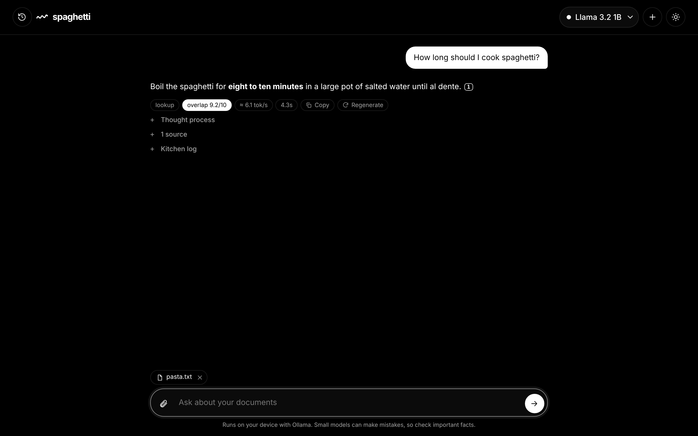
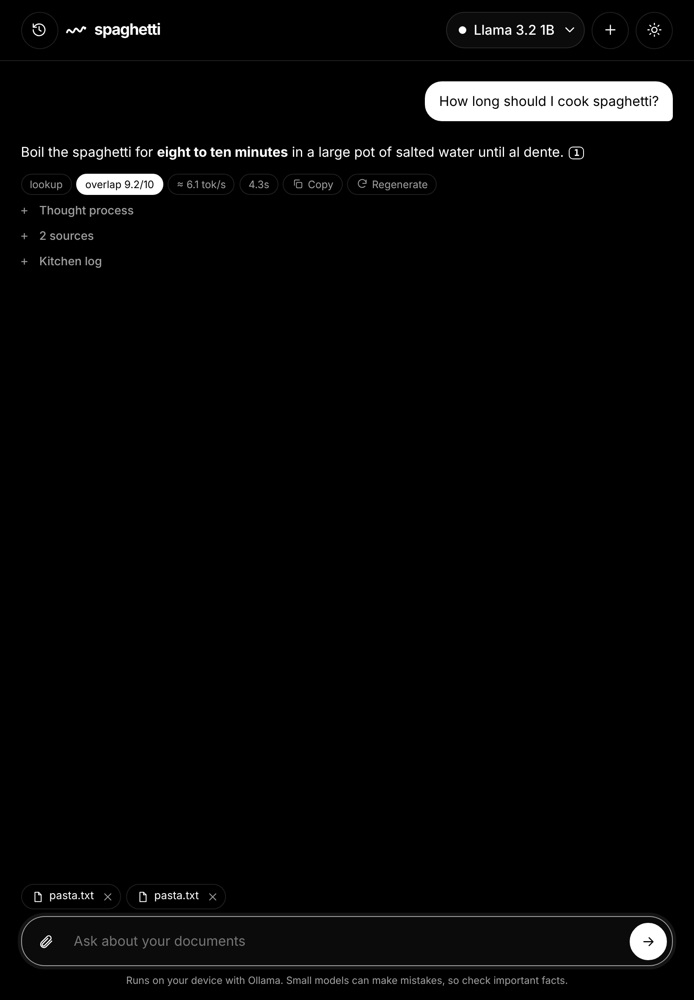
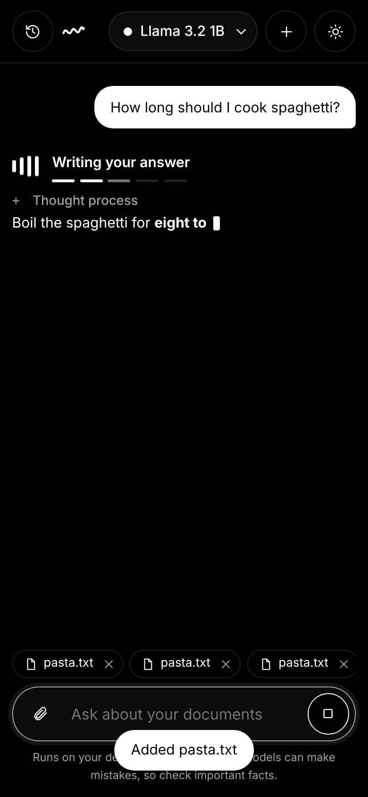
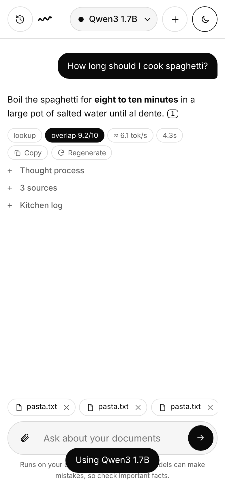
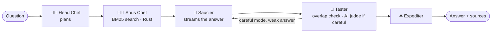

# 🍝 Spaghetti

**Chat with your own documents, privately, on your own laptop.** Five small "agents" plan, search, write, check and serve each answer using a model that runs locally through [Ollama](https://ollama.com). No cloud, no accounts, no API keys.

    


<p align="center">  </p>

> Screenshots come from a real browser run against a **fake Ollama** (my sandbox could not run a model), so the UI behaviour is real and the answers are canned.

## Why I built it
Small local models are private but slow and easy to fool. I wanted to see how far careful engineering (retrieval, streaming, a measured evaluation loop) could close that gap, without frameworks or a cloud.

## Highlights
| | |
|---|---|
| 💬 **Streaming chat** | Tokens appear live, with stop, regenerate, copy, code blocks and saved conversations. Each app launch opens a fresh chat; previous chats remain in history. |
| 🧠 **Model menu** | Auto-picks a model that fits your hardware, starts Ollama, downloads small models (≤ 3B) with live progress. |
| 📎 **Your documents** | Paperclip or drag-and-drop: PDF, DOCX and text formats. Full-document summaries process every chunk. Deletion removes the pantry copy and redacts saved answers that cite it while preserving chat history. |
| ⚡ **Fast by default** | One model call for ordinary questions. Full-document summaries use bounded map/reduce calls; opt-in *Careful mode* adds an AI judge, widens retrieval on weak answers, and retries once. |
| 🌗 **True-OLED UI** | Black or white theme with a smooth reveal. One codebase for desktop, tablet and phone. |
| 📊 **Measured** | 28-case evaluation harness with CI gates, 85 tests, 0 accessibility violations. |

## Quick start
Run these commands from the repository root (the folder containing `run.py`). If VS Code opened the enclosing `spaghetti-project` folder, first run `cd .\spaghetti`:
```bash
python -m pip install -r requirements.txt
python run.py            # opens http://127.0.0.1:8000
python run.py setup      # pick a model for your hardware + write a one-click Ollama install script
python run.py test       # 85 tests
python run.py eval       # evaluation harness (see docs/EVALUATION.md)
```
Needs Python 3.10+. Rust is optional: if `cargo` is installed the fast core is built automatically, otherwise a pure-Python twin runs and tests prove both agree.
First run: the app finds your Ollama models and picks one. If Ollama is missing, the model menu offers a setup script, a manual link and a **Re-check** button.

## Local configuration
`run.py` loads the root `.env` before parsing CLI defaults. The real `.env` is ignored by git; `.env.example` is the safe template. Edit `SPAGHETTI_DATA` to choose where local documents are stored (relative paths resolve from the project root). Process environment variables take precedence over `.env`, and CLI options take precedence over both.

## How it works

```text
frontend/ (one page) ──HTTP + NDJSON stream──▶ api/ ──▶ kitchen/ ──▶ domain/
                                                 │          ├──▶ pantry/ ──▶ engine/ ──▶ 🦀 core-rust
                                                 │          └──▶ runtimes/ollama
                                                 └──▶ advisor/ (model menu, hardware fit)
```
Inner layers never import outer ones, so the whole pipeline is tested with fake models and no network.

## Engineering decisions
| Decision | Why / trade-off |
|---|---|
| **Rust for prep, Python for glue** | chunking, BM25, overlap and a hardware probe are pure and fast. The boundary is plain text over stdin/stdout (no FFI), with a Python twin and parity tests, so Rust stays optional. |
| **Fast mode by default** | A judge call doubles latency on small models. A free Rust word-overlap score replaces it; the AI judge is opt-in. |
| **Streaming over NDJSON** | Plain HTTP, no websockets. Closing the tab closes the generator and stops Ollama. |
| **BM25, not embeddings** | Zero downloads and easy to explain. Trade-off: no synonyms (two eval cases document this on purpose). |
| **Relevance filter (40% word coverage)** | Chosen from an ablation, not a guess: abstention 0.8 → 1.0 with no retrieval loss. |
| **No framework UI** | ES modules + CSS. Only `transform`/`opacity` animate, so streaming stays smooth. |
| **Security by allowlist** | Downloadable models and the setup script only accept tags from the built-in menu; CORS allows exact origins only; a strict Content-Security-Policy (no inline scripts, no `eval`) is applied locally and on Cloudflare Pages via `frontend/_headers`. |

## Quality, and how to reproduce it
| Area | Result | Command |
|---|---|---|
| Tests | 85 passing (unit, integration, Rust parity, harness) | `python run.py test` |
| Evaluation | hit@k 1.0 · citation 1.0 · abstention 1.0 · injection resistance 1.0 (26 gated cases, offline mock) | `python run.py eval` |
| Retrieval only (no model) | same gates, plus k × coverage ablation | `python run.py eval --retrieval-only` |
| Performance | 0 long tasks, worst frame 17 ms while streaming (headless Chromium, 1-core sandbox) | Playwright script in docs |
| Accessibility | axe-core: 0 violations, light and dark | — |
| Browser QA | 19 end-to-end checks pass in Chromium (stop, regenerate, careful mode, history, persistence, shortcuts, error paths, CSP) | Playwright script |

The eval mock is extractive, so these numbers prove **plumbing and retrieval, not model quality**. Run `python run.py eval --model qwen3:1.7b` on your machine for real numbers. Details and honest limits: [docs/EVALUATION.md](docs/EVALUATION.md).

## Deploy the UI on Cloudflare Pages
The page is static, so Cloudflare Pages can host it (output directory `frontend`, no build step). Your documents and model stay on your computer: the hosted page talks to your own backend at `http://127.0.0.1:8000`.
```bash
python run.py --allow-origin https://<your-project>.pages.dev
```
Cloudflare cannot run the Python backend, the Rust core or Ollama, which is the point of the design. Steps, browser support and the security trade-off: [docs/DEPLOY.md](docs/DEPLOY.md).

## Project layout
```text
run.py            one file: serve · setup · test · eval · build · check
backend/spaghetti domain · kitchen · advisor · runtimes · pantry · engine · api
core-rust/        std-only Rust crate (chunk, BM25, overlap, hardware probe)
frontend/         index.html · css · js (chat, picker, docs, theme)
eval/             dataset · metrics · harness · thresholds · baseline
tests/            85 tests      docs/   architecture · models · evaluation · deploy · defense
```

## Limitations and roadmap
- Keyword search (no synonyms), text, PDF and DOCX documents, small models make mistakes.
- Not verified here: a real Ollama install, real model quality/speed, the live Cloudflare deployment, Safari.
- Next: embeddings behind the same `rank` interface and authenticated remote mode.

## What I learned
Measure before tuning (the ablation changed my threshold), keep a pure-Python fallback for every native component, and write the evaluation harness *before* trusting a number.

MIT licensed.
