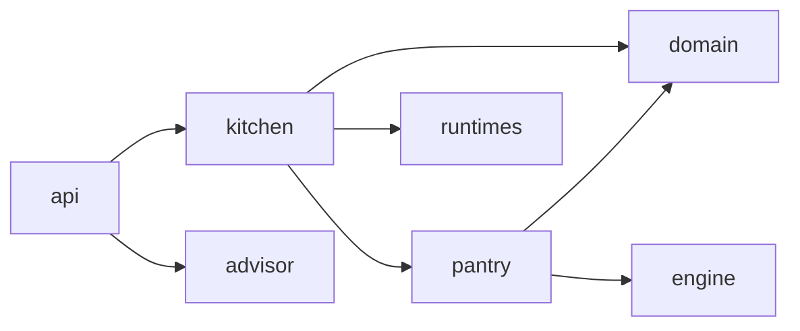
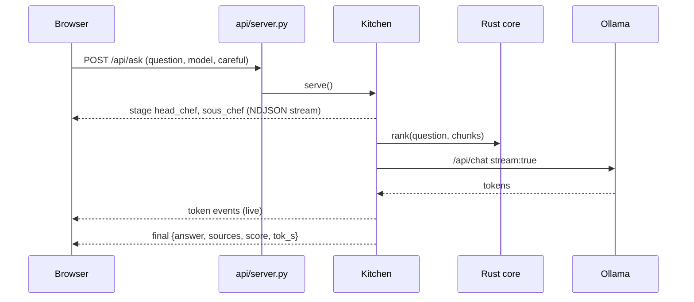

# 🏗️ Architecture

## Layers and the one rule

**Rule:** inner layers never import outer layers.

| Layer | Knows about | Must NOT know about |
|---|---|---|
| `domain/` | nothing | HTTP, files, model runtimes |
| `kitchen/` | domain, pantry, runtimes (through the `ChatModel` port) | HTTP, which runtime it is |
| `pantry/` | domain, engine | HTTP, LLMs |
| `runtimes/` | HTTP to Ollama, the browser bridge | the kitchen |
| `advisor/` | catalog + rules (pure) | HTTP, files |
| `engine/` | subprocess / math | everything else |
| `api/` | everything (it is the outermost layer) | business rules |

Why it matters for a beginner: you can test the kitchen with a fake model (see `tests/test_kitchen.py`) without a network or a downloaded model.

## Request lifecycle

Events are newline-delimited JSON over a normal HTTP response; if the tab closes, the generator is closed and Ollama stops generating.

## Frontend (one page, no framework)
`main.js` wires `chat.js` (streaming, history), `picker.js` (model menu + downloads), `docs.js` (attachments), `theme.js`, `store.js`, `api.js`. Only `transform` and `opacity` animate. `setHTML` skips re-renders when nothing changed.
