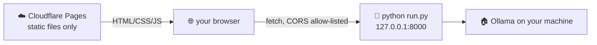

# ☁️ Hosting the UI on Cloudflare Pages


Cloudflare serves **only the static UI**. Chat, documents, the Rust core and the model all stay on your computer.

## 1. Deploy the static site
**Git integration:** Pages → Create project → connect the repo → framework preset *None*, build command *(empty)*, output directory `frontend`.
**Or CLI:** `npx wrangler pages deploy frontend --project-name spaghetti`

## 2. Start your local backend and allow your Pages origin
```bash
python run.py --allow-origin https://spaghetti.pages.dev      # use your real *.pages.dev or custom domain
```
## 3. Open the Pages URL
The UI detects it is not served by the backend and calls `http://127.0.0.1:8000`. To use another address, open the page once with `?api=http://127.0.0.1:9000` (remembered). If the backend is unreachable, the model menu shows the exact command to run.

`frontend/_headers` is picked up by Pages automatically: strict CSP (`script-src 'self'`, no inline scripts, no `eval`; `connect-src` limited to the page itself and `127.0.0.1`/`localhost`), `nosniff`, `no-referrer`. The Python backend sends the same headers locally, so both behave identically.

## Document deletion and chat history
Chats remain in this browser's local storage and return after a refresh. Removing a document removes it from the local pantry file and in-memory index; saved assistant answers and source previews that cite it are redacted while the conversation and user prompts remain. If the browser blocks updating saved chats, the UI reports that separately. This is application-level deletion, not a guarantee of erasure from filesystem snapshots or device backups.

## Browser support
| Browser | Status |
|---|---|
| Chrome / Edge / Brave | allowed for localhost; Chrome may show a one-time "access other apps and services on this device" prompt (the backend answers the required `Access-Control-Allow-Private-Network` preflight) |
| Firefox | allowed for localhost |
| Safari | blocks an https page calling `http://127.0.0.1`: use the local URL `http://127.0.0.1:8000` instead |

**Verified:** two different origins in Chromium on one machine (allowed origin streams a full answer; a non-allowed origin is blocked and the UI explains the fix). **Not verified:** the live Cloudflare deployment, Firefox, Safari.

## Security trade-off (read this)
- CORS allows **exact origins only** (`SPAGHETTI_ALLOW_ORIGIN` / `--allow-origin`), never `*`. With no flag, no website can call your backend.
- The backend still binds to `127.0.0.1` and has no login. Anyone who controls an allowed origin's JavaScript can use *your* backend while you have that page open (read your documents, run your model). **Only allow origins you control, and protect your Cloudflare account.**
- Pages receives nothing but static-file requests. No prompts or documents are sent to Cloudflare.

## Why not run the backend on Cloudflare?
Workers cannot run Ollama or spawn the Rust binary, and Workers AI would move your prompts to the cloud, which defeats the project. A remote mode would need authentication; it is on the roadmap, not built.
